  

<h1 align="center">Hi, I'm Alkesh Srivastava 👋</h1>

  <b>Full-Stack Developer</b> · Building clean, interactive web experiences 
  <i>JavaScript · TypeScript · Python · WebAssembly</i>

  
  
  

---

### 🧑‍💻 About me
- 🔭 Building **[Ben 10 // Omniverse Protocol](https://github.com/Alksri/Ben-10-Encyclopedia)** — a cinematic, interactive fan archive (55+ forms, 10 dossiers, Omnitrix transitions).
- 🎮 Shipped **[wooden-pong](https://github.com/Alksri/wooden-pong)** — classic Pong with a procedural wooden aesthetic, Python/Pygame compiled to WebAssembly.
- 💳 Built **[brightloop-subscription-management](https://github.com/Alksri/brightloop-subscription-management)**.
- 🏆 Competing in **Smart India Hackathon** — `SIH26084`, `sih26188sample`.
- 🧪 Exploring modern web stacks, TypeScript and interactive UI.

### 🧰 Tech stack

  
  
  
  
  
  
  
  

### 📊 GitHub stats

  
  

### 🚀 Featured projects
| Project | Description | Stack |
|---|---|---|
| [Ben-10-Encyclopedia](https://github.com/Alksri/Ben-10-Encyclopedia) | Cinematic interactive Ben 10 archive — 55+ forms, 10 dossiers | JS · HTML · CSS |
| [wooden-pong](https://github.com/Alksri/wooden-pong) | Classic Pong, procedural wooden aesthetic, compiled to WASM | Python · Pygame · WASM |
| [brightloop-subscription-management](https://github.com/Alksri/brightloop-subscription-management) | Subscription management app | JS |
| [SIH26084](https://github.com/Alksri/SIH26084) | Smart India Hackathon project | HTML |
| [sih26188sample](https://github.com/Alksri/sih26188sample) | SIH sample project | TypeScript |
| [Drum-Game](https://github.com/Alksri/Drum-Game) | Interactive drum game | — |
| [builddsmnru](https://github.com/Alksri/builddsmnru) | Builder project | — |

---

  

<i>Building things that feel alive.</i>

